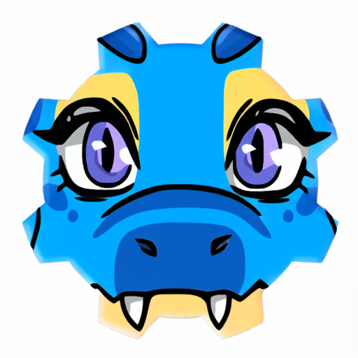
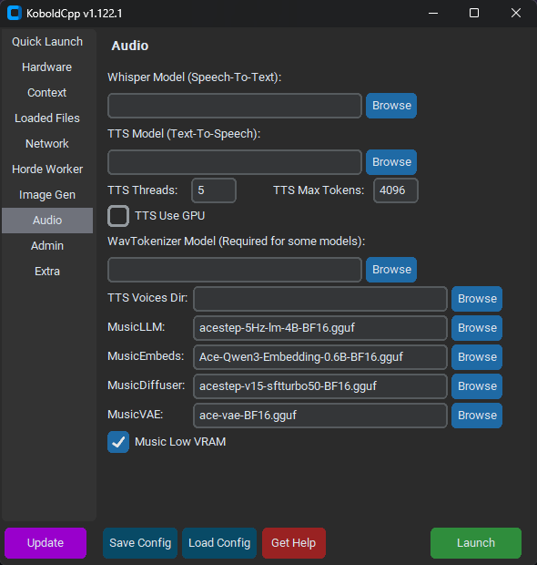

## KoboldCpp ##

Website: https://koboldcpp.net/  
GitHub: https://github.com/lostruins/koboldcpp

### KoboldCpp: Lokale KI-Modelle mit integrierter Web-Benutzeroberfläche ausführen ###

_KoboldCpp_ ist eine kostenlose Open-Source-Software, mit der Sie große Sprachmodelle (LLMs) von GGUF auf Ihrem eigenen Computer ausführen können. Chatten Sie mit einem KI-Assistenten, schreiben Sie Geschichten, spielen Sie Rollenspiele oder verbinden Sie andere Apps mit einer lokalen API. KoboldCpp läuft auf CPU oder GPU und umfasst zudem die Generierung von Text, Bildern, Videos, Sprache und Musik mit kompatiblen Modellen, einen integrierten Agenten, eine mitgelieferte _KoboldAI Lite_-Web-UI sowie viele weitere leistungsstarke Funktionen.

Inspiriert von **KoboldAI** und basierend auf **llama.cpp**

Eine einzige ausführbare Datei, keine Installation erforderlich. Sofort einsatzbereite Downloads sind für Windows, Linux und macOS verfügbar.

---

## Benutzeroberflächen (Web-GUI) ##

Hier ist der Standardport ``5001`` angegeben. Ggf. anpassen.

| Bezeichnung   | URL                           | Hinweise                  |
|---------------|-------------------------------|---------------------------|
| KoboldAI Lite | http://localhost:5001/        | Chat                      |
| Stable UI     | http://localhost:5001/sdui    | Bild-/Videogenerierung    |
| MusicUI       | http://localhost:5001/musicui | Musik-/Stimmengenerierung |
| lama cpp UI   | http://localhost:5001/lcpp/   | Agent                     |

---

## Bildgenerierung ##

Mit _KoboldCpp_ können Bilder generiert werden.

### Qwen Image 2.1 ###

Seit Version 1.123.1 wird **Qwen Image 2.1** unterstützt. Eine Beispielkonfiguration kann hier herunter geladen werden: [Qwen-Image-2.1.kcppt](https://huggingface.co/koboldcpp/kcppt/resolve/main/Qwen-Image-2.1.kcppt)

Diese _Open Weights_ haben besondere Eigenschaften, welche auf der Website näher vorgestellt werden.

Qwen Image 2.1-Website: [qwen.ai](https://qwen.ai/blog?id=qwen-image-2.1)

---

## Videogenerierung ##

Mit _KoboldCpp_ können Videos via **Wan2.2** (Alibaba) generiert werden. Es werden die Eingabemodalitäten Text-to-Video (T2V), Image-to-Video (I2V) unterstützt.

Wan-Website: https://wan.video/

### Models/Weights ###

Es werden min. drei Dateien benötigt. Hier eine Beispiel-Konfiguration:

| Bezeichnung | Datei                                     | Speicherbedarf |
|-------------|-------------------------------------------|---------------:|
| Image Model | wan2.2-rapid-mega-nsfw-aio-v3.1-Q2_K.gguf | 6,23 GB        |
| Image LLM   | umt5-xxl-encoder-Q4_K_M.gguf              | 3,40 GB        |
| Image VAE   | wan21-vae.safetensors                     | 0,24 GB        |

Die Einträge müssen in dem GUI-Launcher bei **Image Gen** angegeben werden.

Die Videos können mit dem WebUI _Stable UI_ ``http://localhost:5001/sdui`` generiert werden. Bei Videos wird _Video Frames_ (Anzahl der Bilder) sowie _FPS_ (Frames per Second; Bilder pro Sekunde) beachtet.

Video Frames / FPS = Videolänge in Sek. bzw.

Videolänge in Sek × FPS = Video Frames z. B.

5 s × 20 fps = 100 Frames

> _Hinweis:_ Die Generierung von Videos ist _rechenintensiv_ und benötigt relativ viel RAM/VRAM.

---

## Musikgenerierung ##

Mit KoboldCpp kann Musik via **ACE-Step 1.5** generiert werden.

ACE-Step 1.5 Website: https://github.com/ace-step/ACE-Step-1.5

### Models/Weights ###

Es werden min. vier verschiedene Dateien benötigt. Hier eine Beispielkonfiguration bei guter Qualität:

| Bezeichnung   | Datei                                     | Speicherbedarf |
|---------------|-------------------------------------------|---------------:|
| MusicLLM      | acestep-5Hz-lm-4B-BF16.gguf               | 8,38 GB        |
| MusicEmbeds   | Ace-Qwen3-Embedding-0.6B-BF16.gguf        | 1,20 GB        |
| MusicDiffuser | acestep-v15-sftturbo50-BF16.gguf          | 4,79 GB        |
| MusicVAE      | ace-vae-BF16.gguf                         | 0,34 GB        |

https://huggingface.co/koboldcpp/music

---
