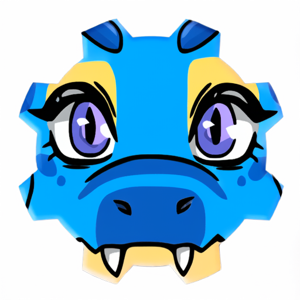
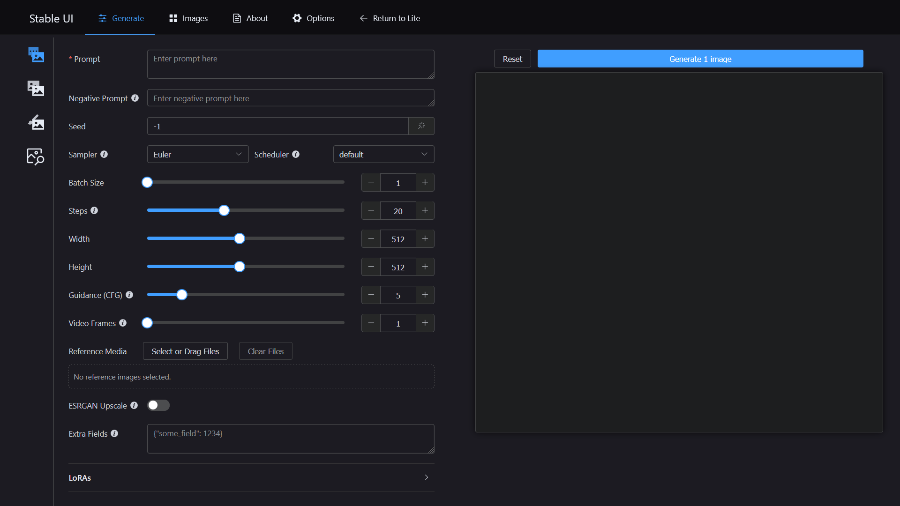
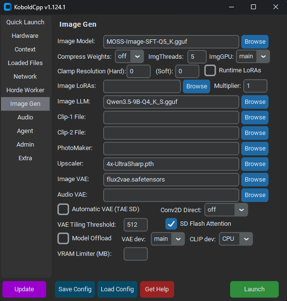
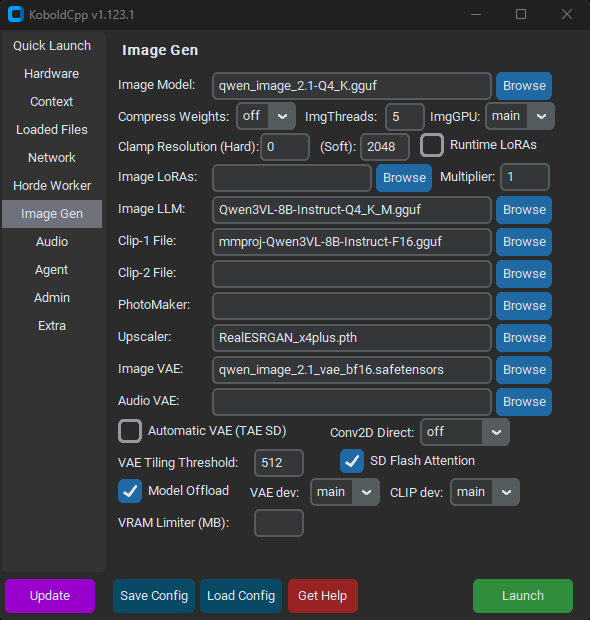
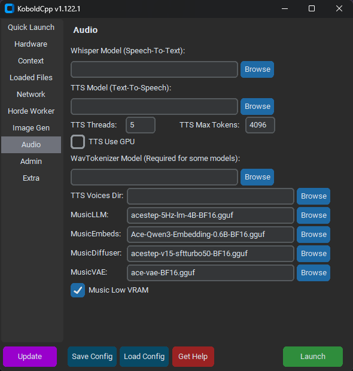

## KoboldCpp ##



Website: [koboldcpp.net](https://koboldcpp.net/ "https://koboldcpp.net")  
GitHub: [github.com/lostruins](https://github.com/lostruins/koboldcpp "https://github.com")

## Übersicht ##

- [Benutzeroberflächen](##benutzeroberfl%C3%A4chen-web-gui)
- [Bildgenerierung](#bildgenerierung) – Text-zu-Bild, Bild-zu-Bild
  - [MOSS-Image](#moss-image)
  - [Qwen Image 2.1](#qwen-image-21)
- [Bildbearbeitung](#bildbearbeitung) – Text-zu-Bild, Bild-zu-Bild
- [Videogenerierung](#videogenerierung) – Text-zu-Video

---

### KoboldCpp: Lokale KI-Modelle mit integrierter Web-Benutzeroberfläche ausführen ###

_KoboldCpp_ ist eine kostenlose Open-Source-Software, mit der große Sprachmodelle (LLMs) von GGUF auf dem eigenen Computer ausgeführt werden können. Mit einem KI-Assistenten chatten, Geschichten schreiben, Rollenspiele spielen oder andere Apps mit einer lokalen API verbinden. KoboldCpp läuft auf CPU oder GPU und umfasst zudem die Generierung von Text, Bildern, Videos, Sprache und Musik mit kompatiblen Modellen, einen integrierten Agenten, eine mitgelieferte _KoboldAI Lite_-Web-UI sowie viele weitere leistungsstarke Funktionen.

Inspiriert von **KoboldAI** und basierend auf **llama.cpp**

Eine einzige ausführbare Datei, keine Installation erforderlich. Sofort einsatzbereite Downloads sind für Windows, Linux und macOS verfügbar.

---

## Benutzeroberflächen (Web-UI) ##

Hier ist der Standardport ``5001`` angegeben. Ggf. anpassen.

| Bezeichnung   | URL                           | Hinweise                  |
|---------------|-------------------------------|---------------------------|
| KoboldAI Lite | http://localhost:5001/        | Chat                      |
| Stable UI     | http://localhost:5001/sdui    | Bild-/Videogenerierung    |
| MusicUI       | http://localhost:5001/musicui | Musik-/Stimmengenerierung |
| lama cpp UI   | http://localhost:5001/lcpp/   | Agent                     |

---

## Bildgenerierung ##

Mit _KoboldCpp_ können Bilder generiert werden. – Die Bildgenerierung basiert auf [stable-diffusion.cpp](https://github.com/leejet/stable-diffusion.cpp/tree/master).

### Stable UI

Die Benutzeroberfläche zur Bildgenerierung wird per Standard über folgende Adresse im Browser aufgerufen:

URI: http://localhost:5001/sdui



*Screenshot der Benutzeroberfläche Stable UI*

---

### MOSS-Image ###

| Parameter | Wert                                                                                                                | Hinweise     |
|-----------|:-------------------------------------------------------------------------------------------------------------------:|--------------|
| Website   | [openmoss.ai](https://openmoss.ai/MOSS-Image/)                                                                      | China        |
| Template  | [Moss-Image.kcppt](https://huggingface.co/koboldcpp/kcppt/resolve/main/Moss-Image.kcppt "https://huggingface.co/")  | Hugging Face |

Seit Version 1.124 wird **MOSS-Image** unterstützt. Eine Beispiel-Konfiguration kann hier herunter geladen werden: [Moss-Image.kcppt](https://huggingface.co/koboldcpp/kcppt/resolve/main/Moss-Image.kcppt "https://huggingface.co/")



*Beispiel-Konfiguration mit optionalem Upscaler.*

Es existieren zwei Versionen: Base und SFT (Supervised Fine-Tuned). Das Base-Modell dient als Grundlage für eigenes Training (wie LoRAs oder Fine-Tuning). Das SFT-Modell kann direkt zum Generieren von Bildern aus Prompts genutzt werden.

Die Modells verstehen Anweisungen in natürlicher Sprache (Englisch und Chinesisch), verarbeiten Tags und unterstützen experimentelle JSON-Layouts, um Text und Objekte gezielt im Bild zu platzieren.

## Inference-Parameter

| Parameter | Wert    | Hinweise |
|-----------|:-------:|----------|
| Sampler   | Euler   ||
| Scheduler | Simple  ||
| Steps     | 28      | 20–40 |
| CFG Scale | 3       | 3–6   |
| Auflösung | 1024×1024 | Vielfache von 16  |

---

### Qwen Image 2.1 ###

- Website: [qwen.ai](https://qwen.ai/blog?id=qwen-image-2.1)

Seit Version 1.123.1 wird **Qwen Image 2.1** unterstützt. Eine Beispiel-Konfiguration kann hier herunter geladen werden: [Qwen-Image-2.1.kcppt](https://huggingface.co/koboldcpp/kcppt/resolve/main/Qwen-Image-2.1.kcppt "https://huggingface.co/")



*Beispiel-Konfiguration mit optionalem Upscaler.*

Diese _Open Weights_ haben besondere Eigenschaften, welche auf der Website näher vorgestellt werden.

Qwen Image 2.1-Website: [qwen.ai](https://qwen.ai/blog?id=qwen-image-2.1)

#### Bildbearbeitung ####

Die Bildbearbeitung findet nicht mit den gesonderten Bereichen von _Stability UI statt,_ sondern werden direkt im Prompt benannt.

```
Change the color of the hair.
```

#### Transparenz ####

_Qwen Image 2.1_ unterstützt transparente Bilder. – Hier ein Beispiel-Prompt:

```
This is an RGBA image with transparency. <your description>. The image has alpha channel and the background is transparent.
```

---

## Videogenerierung ##

Mit _KoboldCpp_ können Videos via **Wan2.2** (Alibaba) generiert werden. Es werden die Eingabemodalitäten Text-to-Video (T2V), Image-to-Video (I2V) unterstützt.

Wan-Website: https://wan.video/

### Models/Weights ###

Es werden min. drei Dateien benötigt. Hier eine Beispiel-Konfiguration:

| Bezeichnung | Datei                                     | Speicherbedarf |
|-------------|-------------------------------------------|---------------:|
| Image Model | wan2.2-rapid-mega-nsfw-aio-v3.1-Q2_K.gguf | 6,23 GB        |
| Image LLM   | umt5-xxl-encoder-Q4_K_M.gguf              | 3,40 GB        |
| Image VAE   | wan21-vae.safetensors                     | 0,24 GB        |

Die Einträge müssen in dem GUI-Launcher bei **Image Gen** angegeben werden.

Die Videos können mit dem WebUI _Stable UI_ ``http://localhost:5001/sdui`` generiert werden. Bei Videos wird _Video Frames_ (Anzahl der Bilder) sowie _FPS_ (Frames per Second; Bilder pro Sekunde) beachtet.

Video Frames / FPS = Videolänge in Sek. bzw.

Videolänge in Sek × FPS = Video Frames z. B.

5 s × 20 fps = 100 Frames

> _Hinweis:_ Die Generierung von Videos ist _rechenintensiv_ und benötigt relativ viel RAM/VRAM.

---

## Musikgenerierung ##

Mit KoboldCpp kann Musik via **ACE-Step 1.5** generiert werden.

ACE-Step 1.5 Website: https://github.com/ace-step/ACE-Step-1.5

### Models/Weights ###

Es werden min. vier verschiedene Dateien benötigt. Hier eine Beispielkonfiguration bei guter Qualität:

| Bezeichnung   | Datei                                     | Speicherbedarf |
|---------------|-------------------------------------------|---------------:|
| MusicLLM      | acestep-5Hz-lm-4B-BF16.gguf               | 8,38 GB        |
| MusicEmbeds   | Ace-Qwen3-Embedding-0.6B-BF16.gguf        | 1,20 GB        |
| MusicDiffuser | acestep-v15-sftturbo50-BF16.gguf          | 4,79 GB        |
| MusicVAE      | ace-vae-BF16.gguf                         | 0,34 GB        |

https://huggingface.co/koboldcpp/music



---
