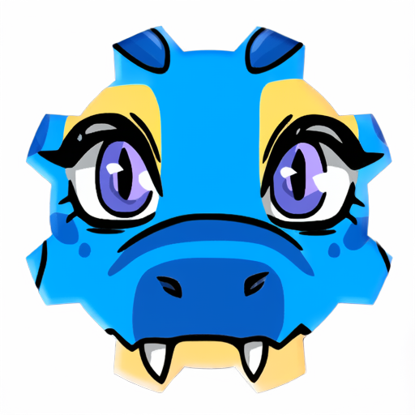
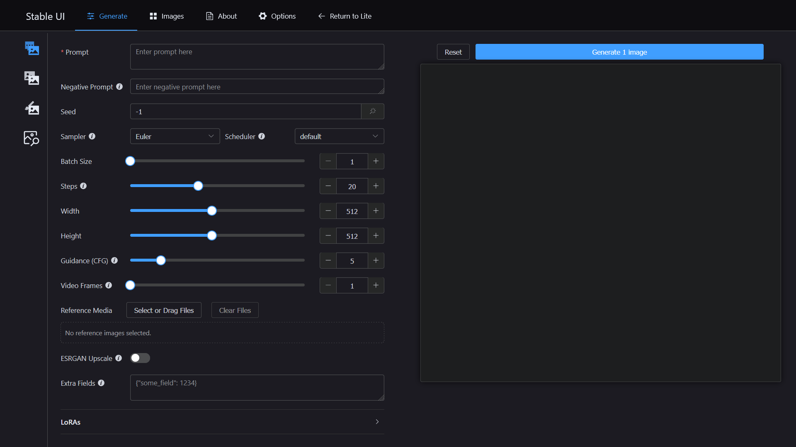
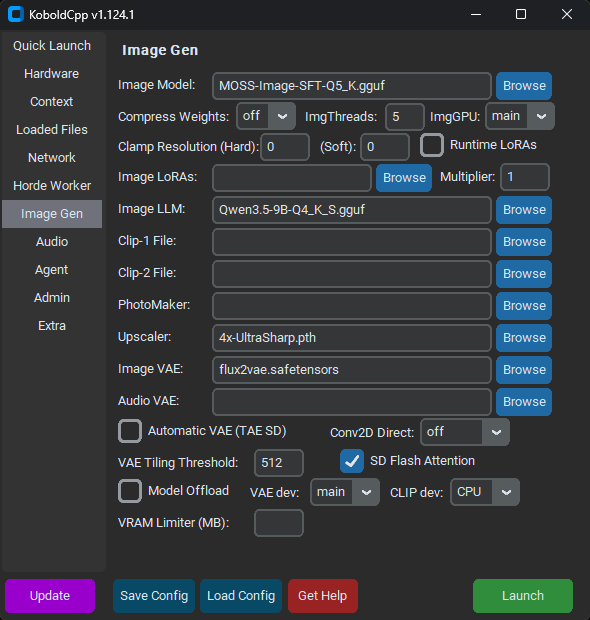
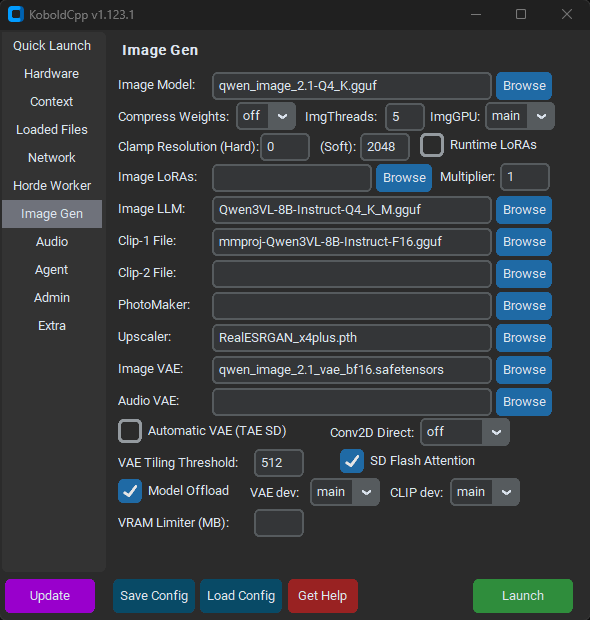
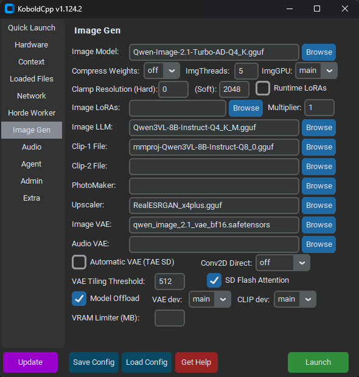
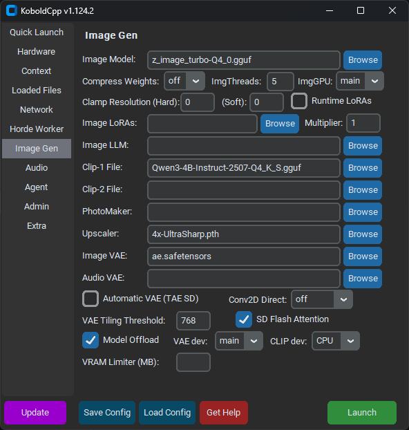
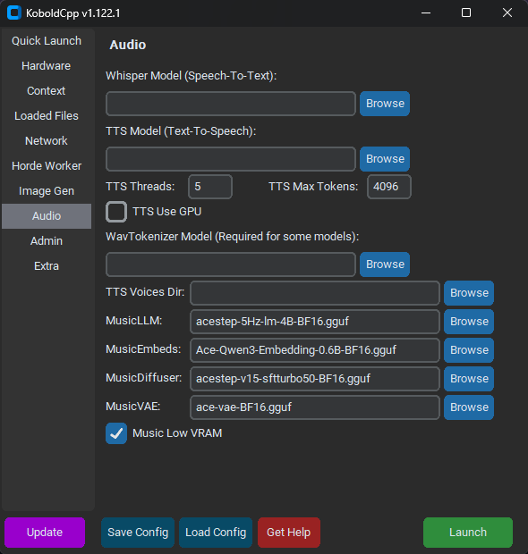

## KoboldCpp ##



|||
|--------------|-------------------------------------------------------------------------------------|
| Website      | [koboldcpp.net](https://koboldcpp.net/ "https://koboldcpp.net")                     |
| GitHub       | [github.com/lostruins](https://github.com/lostruins/koboldcpp "https://github.com") |
| Hugging Face | [huggingface.co](https://huggingface.co/koboldcpp)                                  |
|||

## Übersicht ##

- [Benutzeroberflächen](##benutzeroberfl%C3%A4chen-web-ui)
- [Bildgenerierung](#bildgenerierung) – Text-zu-Bild, Bild-zu-Bild
  - [MOSS-Image](#moss-image)
  - [Qwen Image 2.1](#qwen-image-21)
  - [Qwen Image 2.1 Turbo](#qwen-image-21-turbo)
  - [Z-Image (Base)](#z-image-base)
  - [Z-Image-Turbo](#z-image-turbo)
- [Bildbearbeitung](#bildbearbeitung) – Text-zu-Bild, Bild-zu-Bild
- [Videogenerierung](#videogenerierung) – Text-zu-Video
- [Upscaling](#upscaling)

---

### KoboldCpp: Lokale KI-Modelle mit integrierter Web-Benutzeroberfläche ausführen ###

_KoboldCpp_ ist eine kostenlose Open-Source-Software, mit der große Sprachmodelle (LLMs) von GGUF auf dem eigenen Computer ausgeführt werden können. Mit einem KI-Assistenten chatten, Geschichten schreiben, Rollenspiele spielen oder andere Apps mit einer lokalen API verbinden. KoboldCpp läuft auf CPU oder GPU und umfasst zudem die Generierung von Text, Bildern, Videos, Sprache und Musik mit kompatiblen Modellen, einen integrierten Agenten, eine mitgelieferte _KoboldAI Lite_-Web-UI sowie viele weitere leistungsstarke Funktionen.

Inspiriert von **KoboldAI** und basierend auf **llama.cpp**

Eine einzige ausführbare Datei, keine Installation erforderlich. Sofort einsatzbereite Downloads sind für Windows, Linux und macOS verfügbar.

---

## Benutzeroberflächen (Web-UI) ##

Hier ist der Standardport ``5001`` angegeben. Ggf. anpassen.

| Bezeichnung   | URL                           | Hinweise                  |
|---------------|-------------------------------|---------------------------|
| KoboldAI Lite | http://localhost:5001/        | Chat                      |
| Stable UI     | http://localhost:5001/sdui    | Bild-/Videogenerierung    |
| MusicUI       | http://localhost:5001/musicui | Musik-/Stimmengenerierung |
| lama cpp UI   | http://localhost:5001/lcpp/   | Agent                     |

---

## Bildgenerierung ##

Mit _KoboldCpp_ können Bilder generiert werden. – Die Bildgenerierung basiert auf [stable-diffusion.cpp](https://github.com/leejet/stable-diffusion.cpp/tree/master).

### Stable UI

Die Benutzeroberfläche zur Bildgenerierung wird per Standard über folgende Adresse im Browser aufgerufen:

URI: http://localhost:5001/sdui



*Screenshot der Benutzeroberfläche Stable UI*

---

### MOSS-Image ###

|           |                                                                                                                     | Hinweise     |
|-----------|:-------------------------------------------------------------------------------------------------------------------:|--------------|
| Website   | [openmoss.ai](https://openmoss.ai/MOSS-Image/)                                                                      |              |
| Anbieter  | OpenMOSS Team                                                                                                       | China        |
| GitHub    | [github.com/OpenMOSS](https://github.com/OpenMOSS/MOSS-Image "https://github.com")                                  |              |
| Weights   | [MOSS-Image-SFT-GGUF](https://huggingface.co/leejet/MOSS-Image-SFT-GGUF/tree/main "https://huggingface.co")         | 2,21–5,71 GB |
| Template  | [Moss-Image.kcppt](https://huggingface.co/koboldcpp/kcppt/resolve/main/Moss-Image.kcppt "https://huggingface.co")   | Hugging Face |

Seit Version 1.124 wird **MOSS-Image** unterstützt. Eine Beispiel-Konfiguration kann hier herunter geladen werden: [Moss-Image.kcppt](https://huggingface.co/koboldcpp/kcppt/resolve/main/Moss-Image.kcppt "https://huggingface.co/")



*Beispiel-Konfiguration mit optionalem Upscaler.*

Es existieren zwei Versionen: Base und SFT (Supervised Fine-Tuned). Das Base-Modell dient als Grundlage für eigenes Training (wie LoRAs oder Fine-Tuning). Das SFT-Modell kann direkt zum Generieren von Bildern aus Prompts genutzt werden.

Die Modells verstehen Anweisungen in natürlicher Sprache (Englisch und Chinesisch), verarbeiten Tags und unterstützen experimentelle JSON-Layouts, um Text und Objekte gezielt im Bild zu platzieren.

## Inference-Parameter

| Parameter | Wert    | Hinweise |
|-----------|:-------:|----------|
| Sampler   | Euler   ||
| Scheduler | Simple  ||
| Steps     | 28      | 20–40 |
| CFG Scale | 3       | 3–6   |
| Auflösung | 1024×1024 | Vielfache von 16  |

---

### Qwen Image 2.1 ###

Seit Version 1.123.1 wird **Qwen Image 2.1** unterstützt.

|           |                                                                                                                            | Hinweise     |
|-----------|:--------------------------------------------------------------------------------------------------------------------------:|:------------:|
| Website   | [qwen.ai](https://qwen.ai/blog?id=qwen-image-2.1 "https://qwen.ai")                                                        |              |
| Anbieter  | Qwen Research (Alibaba Cloud)                                                                                              | China        |
| Parameter | 7 Milliarden<br>32 Single-Stream-DiT-Schichten                                                                             |              |
| Lizenz    | [Qwen Research License Agreement](https://github.com/QwenLM/Qwen-Image-2.1/blob/main/LICENSE "(https://github.com")        | Open Weight  |
| Datum     | 2026-09-20                                                                                                                 |              |
| GitHub    | [github.com/QwenLM](https://github.com/QwenLM/Qwen-Image-2.1 "https://github.com")                                         |              |
| Weights   | [Qwen-Image-2.1-GGUF](https://huggingface.co/leejet/Qwen-Image-2.1-GGUF/tree/main "https://huggingface.co")                | 2,56–7,69 GB |
| Template  | [Qwen-Image-2.1.kcppt](https://huggingface.co/koboldcpp/kcppt/resolve/main/Qwen-Image-2.1.kcppt "https://huggingface.co/") | Hugging Face |

Ein einheitliches Modell zur Text-zu-Bild-Generierung und Bildbearbeitung aus der Qwen-Familie. Mit nur 7 Milliarden Parametern in seiner Komponente zur visuellen Generierung (32 Single-Stream-DiT-Schichten) schafft *Qwen-Image-2.1* ein ausgewogenes Verhältnis zwischen Generierungsqualität, Inferenz-Effizienz und Vielseitigkeit.

#### Inference-Parameter

| Parameter      | Wert      | Hinweise                                          |
|----------------|:---------:|---------------------------------------------------|
| Sampler        | Euler     |                                                   |
| Scheduler      | default   |                                                   |
| Steps          | 20        | nativ bis 40                                      |
| CFG Scale      | 6.0       |                                                   |
| Auflösung      | 2048×2048 | bis 2K, durch 32 teilbar                          |
| Negativ-Prompt | –         | leer lassen                                       |

Eine Beispiel-Konfiguration kann hier herunter geladen werden: [Qwen-Image-2.1.kcppt](https://huggingface.co/koboldcpp/kcppt/resolve/main/Qwen-Image-2.1.kcppt "https://huggingface.co/")

Diese _Open Weights_ haben besondere Eigenschaften, welche auf der Website näher vorgestellt werden.

Qwen Image 2.1-Website: [qwen.ai](https://qwen.ai/blog?id=qwen-image-2.1)



*Beispiel-Konfiguration mit optionalem Upscaler.*

#### Empfohlene Auflösungen ####

Qwen-Image-2.1 unterstützt von Haus aus eine Auflösung von 2K.

| Serienverhältnis | Pixel     |
|:----------------:|:---------:|
| 1:1              | 2048×2048 |
| 4:3              | 2400×1792 |
| 3:4              | 1792×2400 |
| 3:2              | 2528×1696 |
| 2:3              | 1696×2528 |
| 16:9             | 2752×1536 |
| 9:16             | 1536×2752 |

#### Prompting ####

Am besten **als klare Beschreibung des fertigen Bildes** – vom Hauptmotiv über Szene und Anordnung bis zu Licht und Stil. Nicht nur Schlagwörter aneinanderreihen: Je genauer du wichtige Entscheidungen festlegst, desto weniger muss das Modell selbst erraten.

**Praktische Reihenfolge:**

1. **Motiv und Zweck:** Was soll zu sehen sein – etwa ein Produktfoto, Porträt oder Filmplakat?
2. **Wichtige Merkmale:** Aussehen, Kleidung, Material, Farben und Anzahl.
3. **Anordnung:** Was ist vorn, hinten, links, rechts oder im Zentrum? Beschreibe den Bildaufbau am besten in einer nachvollziehbaren Reihenfolge.
4. **Licht und Stimmung:** Zum Beispiel weiches Morgenlicht, harte Schatten oder neblige Dämmerung.
5. **Stil und Kamera:** Etwa fotorealistisch, Aquarell, Nahaufnahme oder Draufsicht.
6. **Text im Bild:** Den gewünschten Wortlaut exakt in Anführungszeichen setzen und Größe sowie Position beschreiben.
7. **Unerwünschtes:** Bei Bedarf knapp nennen, was nicht erscheinen soll.

**Vorlage für ein neues Bild:**

```text
Ein [Stil/Medium] von [Hauptmotiv] in [Umgebung]. [Merkmale des Motivs]. 
[Anordnung im Bild: Vordergrund, Hintergrund, links/rechts/zentriert]. 
[Beleuchtung und Stimmung]. [Farben, Perspektive und Bildausschnitt]. 
[Optional: exakter Text im Bild und seine Position]. [Wichtige Dinge, die fehlen sollen].
```

*Dieser Text soll zum Verständnis beitragen.* Qwen Image 2.1 *ist auf englische sowie chinesische Prompts trainiert.*

**Beispiel:**

```text
Fotorealistisches Produktfoto einer dunkelgrünen Keramiktasse auf einem hellen Eichentisch.
Die Tasse steht mittig im Bild; rechts liegt ein geschlossenes cremefarbenes Buch, im Hintergrund ist ein unscharfes Fenster zu sehen.
Weiches Morgenlicht fällt von links ein und erzeugt einen sanften Schatten nach rechts.
Ruhige, warme Farben, leicht erhöhte Kameraperspektive, klare Glasurdetails.
Kein Text und keine weiteren Gegenstände.
```

*Dieser Text soll zum Verständnis beitragen.* Qwen Image 2.1 *ist auf englische sowie chinesische Prompts trainiert.*

Bei **Bildbearbeitung** trenne deutlich, was sich ändern soll und was erhalten bleiben muss: „Ersetze den Hintergrund durch …; Gesicht, Pose, Kleidung und Bildausschnitt unverändert lassen.“

#### Bildbearbeitung ####

Die Bildbearbeitung findet nicht mit den gesonderten Bereichen von _Stability UI statt,_ sondern werden direkt im Prompt benannt.

```
Change the color of the hair.
```

#### Transparenz ####

_Qwen Image 2.1_ unterstützt transparente Bilder. – Hier ein Beispiel-Prompt:

```
This is an RGBA image with transparency. <your description>. The image has alpha channel and the background is transparent.
```

---

### Qwen Image 2.1 Turbo ###

*Qwen Image 2.1 Turbo* ist eine beschleunigte Version von *Qwen Image 2.1*. Bis auf das Model wird die Inferenz mit der gleichen Pipeline geladen. Daher kann das gleiche Template genutzt werden; es wird nur das Model gegen die Turbo-Variante getauscht.

|                        |                                                                                                                                      | Hinweise     |
|------------------------|:------------------------------------------------------------------------------------------------------------------------------------:|:------------:|
| Website                | [qwen.ai](https://qwen.ai/blog?id=qwen-image-2.1 "https://qwen.ai")                                                                  |              |
| Anbieter               | Qwen Research (Alibaba Cloud)                                                                                                        | China        |
| Parameter              | 7 Milliarden<br>32 Single-Stream-DiT-Schichten                                                                                       |              |
| Lizenz                 | [Qwen Research License Agreement](https://github.com/QwenLM/Qwen-Image-2.1/blob/main/LICENSE "(https://github.com")                  | Open Weight  |
| Datum                  | 2026-10-09                                                                                                                           |              |
| GitHub                 | [github.com/QwenLM](https://github.com/QwenLM/Qwen-Image-2.1 "https://github.com")                                                   |              |
| Hugging Face           | [huggingface.co/Qwen](https://huggingface.co/Qwen/Qwen-Image-2.1-Turbo "https://huggingface.co")                                     |              |
| Weights (Atomic Chat)  | [Qwen-Image-2.1-Turbo-GGUF](https://huggingface.co/AtomicChat/Qwen-Image-2.1-Turbo-GGUF/tree/main "https://huggingface.co")          | 2,55–14,2 GB |
| Weights (Ahmet Benzer) | [Qwen-Image-2.1-Turbo-Quantized](https://huggingface.co/abenzerps/Qwen-Image-2.1-Turbo-Quantized/tree/main "https://huggingface.co") | 2,55–7,69 GB |
| Template               |  |  |

#### Beispiel-Konfiguration ####



*Beispiel-Konfiguration mit optionalem Upscaler.*

#### Unterschiede ####

Dieses Open-Weight nutzt ausschließlich ``8 Steps`` (Schritte) zur Bildgenerierung. Der *Guidance-Wert* (CFG) ist fest auf ``1`` eingestellt. Andere CFG-Werte erzeugen unscharfe Bilder. Als Sampler kommt ``Euler`` zum Einsatz und der Scheduler ist ``simple``.   
Zusätzlich nutzt dieses Model eine vorgegebene *Turbo-Sigmafolge*.

Damit diese Werte beachtet werden, sollten sie in das Feld ``Extra Fields`` im JSON-Format eingetragen werden:

```json
{
  "steps": 8,
  "cfg_scale": 1,
  "negative_prompt": "",
  "sigmas": [1.0, 0.978453, 0.95418, 0.926626, 0.89508, 0.845148, 0.704534, 0.414568, 0.0]
}
```

Bei fehlenden Sigmas-Werten wird das Bild in falschen Farben (schwarzweiß) generiert.

#### Inference-Parameter

| Parameter      | Wert      | Hinweise        |
|----------------|:---------:|-----------------|
| Sampler        | Euler     |                 |
| Scheduler      | simple    |                 |
| Steps          | 8         | fest vorgegeben |
| CFG Scale      | 1         | fest vorgegeben |
| Auflösung      | 2048×2048 | 2K              |
| Negativ-Prompt | –         | leer lassen     |

---

### Z-Image (Base)

|          |                                                                                                                     | Hinweise     |
|----------|:-------------------------------------------------------------------------------------------------------------------:|--------------|
| Website  | [z-image.net](https://z-image.net/de "https://z-image.net")                                                         | China        |
| GitHub   | [github.com/Tongyi-MAI](https://github.com/Tongyi-MAI/Z-Image "https://github.com")                                 |              |
| Weights  | [Z-Image-GGUF](https://huggingface.co/unsloth/Z-Image-GGUF "https://huggingface.co")                                | 2,31–12,3 GB |
| Template | []()   | Hugging Face |

#### Inference-Parameter

| Parameter | Wert                  | Hinweise                                          |
|-----------|:---------------------:|---------------------------------------------------|
| Sampler   | Euler                 |                                                   |
| Scheduler | Simple                |                                                   |
| Steps     | 28                    | 28 – 50                                           |
| CFG Scale | 3.0                   | 3.0 – 5.0                                         |
| Auflösung | 512×512 bis 2048×2048 | Gesamtpixelanzahl,<br>beliebiges Seitenverhältnis |

Für Z-Image Base (nicht Turbo) ist Euler + Simple ein guter Startpunkt. In der Modell-Community werden außerdem **Beta** und **SGM Uniform** als Scheduler genannt; als Alternative für mehr Details werden **DPM++ SDE + Beta** oder **Euler Ancestral + Beta** empfohlen. Das sind Community-Empfehlungen, keine verbindliche offizielle Vorgabe.

---

### Z-Image-Turbo

|          |                                                                                                                     | Hinweise     |
|----------|:-------------------------------------------------------------------------------------------------------------------:|--------------|
| Website  | [zimageturbo.com](https://zimageturbo.com/de "https://zimageturbo.com")                                             | China        |
| GitHub   | [github.com/Tongyi-MAI](https://github.com/Tongyi-MAI/Z-Image "https://github.com")                                 |              |
| Weights  | [Z-Image-Turbo-GGUF](https://huggingface.co/leejet/Z-Image-Turbo-GGUF/tree/main "https://huggingface.co")           | 2,59–6,58 GB |
| Template | []()   | Hugging Face |

#### Inference-Parameter

| Parameter | Wert                  | Hinweise                                          |
|-----------|:---------------------:|---------------------------------------------------|
| Sampler   | Euler                 |                                                   |
| Scheduler | default               |                                                   |
| Steps     | 8                     | 8 – 9                                             |
| CFG Scale | 1                     | fest vorgegeben                                   |
| Auflösung | 512×512 bis 2048×2048 | Gesamtpixelanzahl,<br>beliebiges Seitenverhältnis |



---

## Upscaling ##

| upscalers-sdcpp-gguf | URL                                                                         |
|----------------------|-----------------------------------------------------------------------------|
| Model card           | [huggingface.co/wbruna](https://huggingface.co/wbruna/upscalers-sdcpp-gguf) |

Für KoboldCpp würde ich die **GGUF-Dateien aus diesem Hugging-Face-Repo** nehmen: Sie wurden für `stable-diffusion.cpp` konvertiert, dessen Bildgenerierungs-Backend KoboldCpp verwendet. Das ist verlässlicher als beliebige ESRGAN-`.pth`-Dateien, die teils erst konvertiert werden müssen. <citation src="28,31,32"></citation>

| Modell | Geeignet für | Download |
|---|---|---|
| **RealESRGAN_x4plus** | Allrounder, Fotos und gemischte Motive | [GGUF herunterladen](https://huggingface.co/wbruna/upscalers-sdcpp-gguf/resolve/main/RealESRGAN_x4plus.gguf?download=true) |
| **RealESRGAN_x4plus_anime_6B** | Anime, Cartoons und Illustrationen | [GGUF herunterladen](https://huggingface.co/wbruna/upscalers-sdcpp-gguf/resolve/main/RealESRGAN_x4plus_anime_6B.gguf?download=true) |
| **4xLSDIRplusN** | Weitere 4×-Option; vom Backend-Nutzer als funktionierend genannt | [GGUF herunterladen](https://huggingface.co/wbruna/upscalers-sdcpp-gguf/resolve/main/4xLSDIRplusN.gguf?download=true) |
| **4xUltrasharpV10** | Alternative für einen schärferen Look | [GGUF herunterladen](https://huggingface.co/wbruna/upscalers-sdcpp-gguf/resolve/main/4xUltrasharpV10.gguf?download=true) |

Das [gesamte Repo mit Dateiliste und Lizenzhinweisen](https://huggingface.co/wbruna/upscalers-sdcpp-gguf) enthält weitere Modelle. Die Dateien sind 4×-Upscaler; welches Ergebnis am besten aussieht, hängt vom Motiv ab. <citation src="28"></citation>

In KoboldCpp kannst du den Pfad im Image-Generation-Tab als Upscaler angeben; per Kommandozeile lautet die Option `--sdupscaler /pfad/zum/upscaler.gguf`. 

---

### ESRGAN ###

**ESRGAN** steht für **Enhanced Super-Resolution Generative Adversarial Network** – auf Deutsch etwa „verbessertes generatives gegnerisches Netzwerk zur Superauflösung“.

Es bezeichnet eine KI-Methode, die Bilder hochskaliert und dabei fehlende Details möglichst überzeugend ergänzt. „Generative adversarial“ beschreibt das Training zweier neuronaler Netze: Ein Netz erzeugt die vergrößerte Version, das andere beurteilt, wie realistisch sie wirkt.

---

## Videogenerierung ##

Mit _KoboldCpp_ können Videos via **Wan2.2** (Alibaba) generiert werden. Es werden die Eingabemodalitäten Text-to-Video (T2V), Image-to-Video (I2V) unterstützt.

Wan-Website: https://wan.video/

### Models/Weights ###

Es werden min. drei Dateien benötigt. Hier eine Beispiel-Konfiguration:

| Bezeichnung | Datei                                     | Speicherbedarf |
|-------------|-------------------------------------------|---------------:|
| Image Model | wan2.2-rapid-mega-nsfw-aio-v3.1-Q2_K.gguf | 6,23 GB        |
| Image LLM   | umt5-xxl-encoder-Q4_K_M.gguf              | 3,40 GB        |
| Image VAE   | wan21-vae.safetensors                     | 0,24 GB        |

Die Einträge müssen in dem GUI-Launcher bei **Image Gen** angegeben werden.

Die Videos können mit dem WebUI _Stable UI_ ``http://localhost:5001/sdui`` generiert werden. Bei Videos wird _Video Frames_ (Anzahl der Bilder) sowie _FPS_ (Frames per Second; Bilder pro Sekunde) beachtet.

Video Frames / FPS = Videolänge in Sek. bzw.

Videolänge in Sek × FPS = Video Frames z. B.

5 s × 20 fps = 100 Frames

> _Hinweis:_ Die Generierung von Videos ist _rechenintensiv_ und benötigt relativ viel RAM/VRAM.

---

## Musikgenerierung ##

Mit KoboldCpp kann Musik via **ACE-Step 1.5** generiert werden.

ACE-Step 1.5 Website: https://github.com/ace-step/ACE-Step-1.5

### Models/Weights ###

Es werden min. vier verschiedene Dateien benötigt. Hier eine Beispielkonfiguration bei guter Qualität:

| Bezeichnung   | Datei                                     | Speicherbedarf |
|---------------|-------------------------------------------|---------------:|
| MusicLLM      | acestep-5Hz-lm-4B-BF16.gguf               | 8,38 GB        |
| MusicEmbeds   | Ace-Qwen3-Embedding-0.6B-BF16.gguf        | 1,20 GB        |
| MusicDiffuser | acestep-v15-sftturbo50-BF16.gguf          | 4,79 GB        |
| MusicVAE      | ace-vae-BF16.gguf                         | 0,34 GB        |

https://huggingface.co/koboldcpp/music



---


