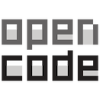

## OpenCode

- Website: [opencode.ai](https://opencode.ai/ "https://opencode.ai")
- GitHub: [github.com/anomalyco](https://github.com/anomalyco/opencode "https://github.com")

---



**OpenCode** ist ein kostenloses Open-Source-Programm, das KI beim Programmieren nutzt – man kann es sich wie einen „KI-Programmierkollegen" vorstellen, der direkt im Terminal (bzw. der Eingabeaufforderung) arbeitet.  
Es existiert zusätzlich eine Desktop-App (Beta) für Windows, macOS und Linux.

---

### Übersicht

- [Browser-Oberfläche starten](#browser-oberfläche-starten)
- [Status des Servers anzeigen](#status-des-servers-anzeigen)
- [Hintergrund-Server beenden](#hintergrund-server-beenden)
- [AGENTS.md](#agentsmd)
- [Syntax](#syntax)

---

### Browser-Oberfläche starten

Einmaligen Link anzeigen, um eine Verbindung über einen Browser oder eine App herzustellen. (Gültigkeit 5 Minuten)

```
opencode pair
```

---

### Status des Servers anzeigen

```
opencode service stat
```

---

### Hintergrund-Server beenden

```
opencode service stop
```

---

### AGENTS.md

Die möglichen Speicherorte

#### 1. Projektbezogen (Standardfall):

```
C:\Users\<DeinName>\Pfad\zum\Projekt\AGENTS.md
```

Diese Datei gilt für dieses eine Projekt. Sie sollte ins Repo committet werden, damit alle im Team dieselben Anweisungen haben.

#### 2. Global (für alle Projekte):

```
C:\Users\<DeinName>\.config\opencode\AGENTS.md
```

Dort gehören nur Regeln hinein, die überall gelten sollen (z. B. allgemeine Stilvorgaben oder „Antworte auf Deutsch").

#### 3. In Unterordnern (optional):

Es können auch weitere ``AGENTS.md`` in Unterverzeichnissen abgelegt werden (z. B. ``packages\web\AGENTS.md``). OpenCode lädt sie, wenn es in diesem Bereich arbeitet – die spezifischeren Dateien gelten zusätzlich zu denen der übergeordneten Ordner.

#### Wichtig zu wissen:
- OpenCode 2.0 erkennt nur ``AGENTS.md`` – anders als früher gibt es keinen ``CLAUDE.md``-Fallback mehr. Eine bestehende ``CLAUDE.md`` muss also umbenannt oder der Inhalt übertragen werden.
- Die Dateien werden kombiniert (nicht überschrieben): zuerst die globale, dann die vom Arbeitsverzeichnis aufwärts bis zum Projektroot.
- Falls OpenCode unter **WSL** betrieben wird (bei Windows üblich), liegt die globale Datei im Linux-Home: ``~/.config/opencode/AGENTS.md``, also z. B. ``\\wsl$\<Distro>\home\<user>\.config\opencode\AGENTS.md``.
- Mit der Umgebungsvariable ``OPENCODE_CONFIG_DIR`` kann das Config-Verzeichnis umgelenkt werden; mit ``OPENCODE_DISABLE_PROJECT_CONFIG=1`` werden die projektbezogenen Dateien deaktiviert.
- Zum Prüfen, was geladen wird: ``opencode debug config`` im Projektordner ausführen.

Falls die Datei nicht erkannt wird: Prüfen, dass sie wirklich im Ordner liegt, aus dem heraus OpenCode gestartet wird, und dass sie nicht versehentlich ``AGENTS.md.txt`` heißt (passiert bei Windows schnell, wenn die Dateiendungen ausgeblendet sind).

---

### Syntax

```shell
DESCRIPTION
  OpenCode command line interface

USAGE
  opencode <subcommand> [flags] [<directory>]

ARGUMENTS
  directory string    Directory to start OpenCode in (optional)

FLAGS
  --standalone            Run with a private server instead of the background service
  --server string         Connect to a server URL instead of the background service
  --auto                  Auto-approve permissions that are not explicitly denied
  --continue, -c          Continue the last session
  --session, -s string    Session ID to continue, or to create if it does not exist
  --prompt string         Prompt to use

GLOBAL FLAGS
  --help, -h                                                          Show help information
  --version, -v                                                       Show version information
  --wizard                                                            Start wizard mode for a command
  --completions <bash|zsh|fish|powershell|sh|pwsh>                    Print shell completion script (choices: bash, zsh, fish, powershell, sh, pwsh)
  --log-level <all|trace|debug|info|warn|warning|error|fatal|none>    Sets the minimum log level (choices: all, trace, debug, info, warn, warning, error, fatal, none)
  --print-logs                                                        Print logs to stderr (server logs require --standalone)

SUBCOMMANDS
  upgrade, update    Upgrade OpenCode to the latest or a specific version
  uninstall          Uninstall OpenCode, keeping session data, configuration, and state
  acp                Start an Agent Client Protocol server
  api                Make a request to the running server
  debug              Debugging and troubleshooting tools
  auth               manage integrations and credentials
  mcp                Manage MCP (Model Context Protocol) servers
  plugin             Manage plugins
  models             List all available models
  stats              Show shareable usage statistics
  mini               Start the minimal interactive interface
  run                Run OpenCode with a message
  session            Manage sessions
  service            Manage the background server
  reload             Reload configuration
  pair               Print one-time links to connect a browser or app
  serve              Start the v2 API and web server
```

---


